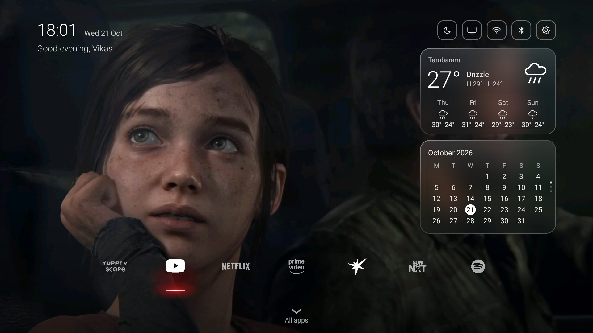
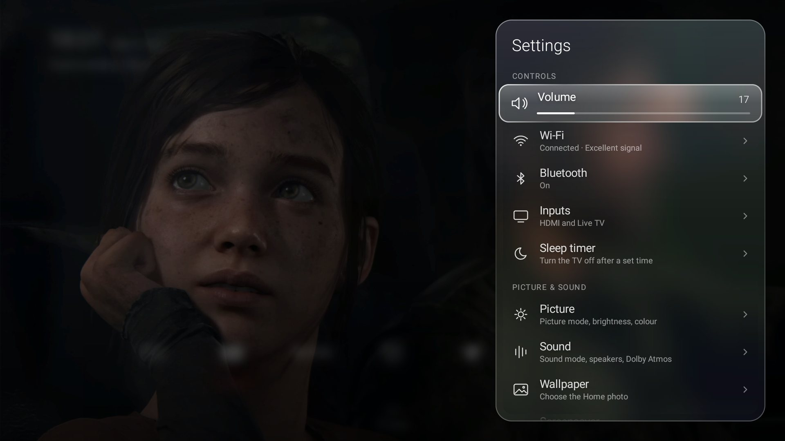
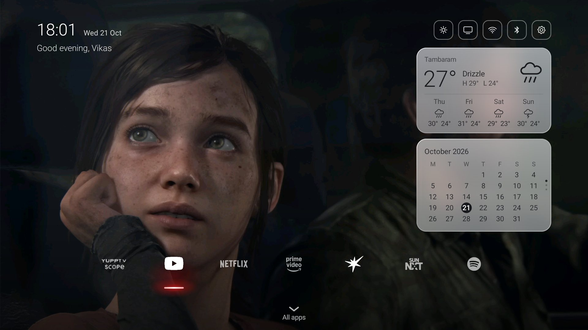
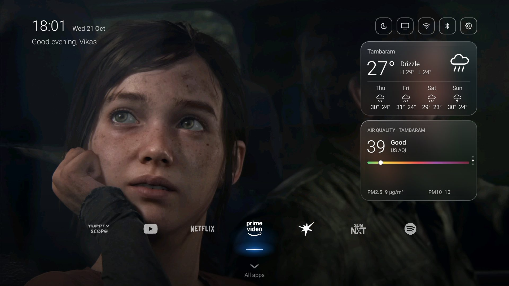
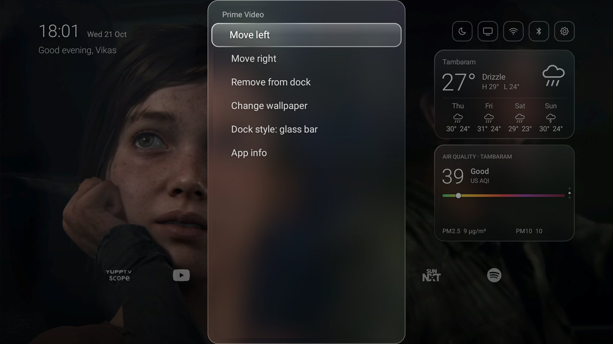
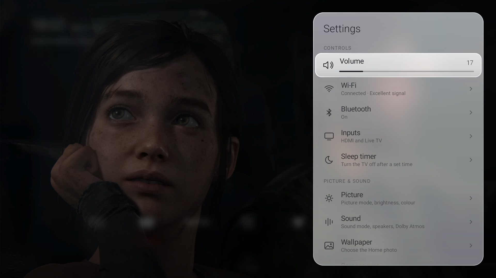

# Vitrine Home

A calm, glass home screen for Android TV and Google TV.



| | |
|---|---|
|  |  |
|  |  |

---

## Install

**You need:** an Android TV / Google TV (Android 9 or later), a computer on the same network with
[adb](https://developer.android.com/tools/releases/platform-tools), and Android Studio or JDK 17+ with
the Android SDK.

1. **On the TV**, turn on developer options: *Settings → System → About*, select *Build* 7 times.
   Then turn on **USB debugging / Network debugging** in *Settings → System → Developer options*,
   and note the TV's IP address (*Settings → Network*).
2. **On your computer**:

   ```sh
   git clone https://github.com/vikaskalyan-rgb/vitrine-home.git
   cd vitrine-home
   scripts/vitrine.sh install 192.168.1.50        # macOS / Linux
   scripts\vitrine.bat install 192.168.1.50       # Windows
   ```

   Use your TV's IP. The first time, the TV asks to **allow debugging**: tick *Always allow*, press *Allow*.
3. Vitrine Home opens as a preview. To make it your home screen:

   ```sh
   scripts/vitrine.sh home 192.168.1.50
   ```

## Using it

### Home

| Button | Does |
|---|---|
| Left / Right | move along the dock |
| OK | open the app |
| Hold OK on a dock app | move it left/right, remove it, change dock style, wallpaper, app info |
| Down | All apps |
| Up | Now Playing (while something plays), then the top buttons |
| 1–9 | open dock app 1–9 |
| Back | close a panel / back to the dock |
| Hold Back for 5 seconds | open the TV's own home screen |

After 20 seconds without a button press, Home goes **quiet**: only the photo, the clock and a dimmed
dock stay. The first press wakes it without doing anything else.

### The dock



- **Add an app:** press Down for All apps, hold OK on the app, choose *Add to dock*.
- **Move or remove:** hold OK on it in the dock.
- Up to 10 apps sit on one row. With 11 or more the dock splits into two centred rows by itself.



### Top buttons

From left to right: **light / dark mode**, **Inputs** (HDMI and Live TV; *Rename inputs…* lets you
call HDMI 1 "PS5"), **Wi-Fi**, **Bluetooth**, and **Settings**.

### Settings

The gear button opens the glass Settings panel: volume (Left/Right to change, OK to mute), Wi-Fi,
Bluetooth, inputs, picture, sound, wallpaper, screensaver, apps, storage, backup, date & time,
restart, **Evening mode** (warm dim from 9 pm to 6 am) and **Reduce motion**. Rows with an arrow open
the TV's own settings page.



### Now Playing and devices

- While music or video plays, a pill appears above the dock: Up to reach it, OK to play/pause,
  Left/Right for previous/next.
- When an HDMI device turns on, a card asks whether to switch to it (needs HDMI-CEC on the device).

### Screensaver


Your wallpapers cross-fade slowly with the clock. Turn it on with:

```sh
scripts/vitrine.sh screensaver 192.168.1.50
```

(it prints the previous screensaver so you can switch back).

## Make it yours

**Wallpapers:** up to 10 landscape photos (1920×1080 or larger) from a folder:

```sh
scripts/vitrine.sh wallpapers 192.168.1.50 ~/Pictures/tv
```

Pick one by holding OK on the gear button.

**Config file (optional):** copy `config.example.json` to `config.json`, edit it, then:

```sh
scripts/vitrine.sh config 192.168.1.50 config.json
```

| Field | What it does |
|---|---|
| `name` | greeting: "Good evening, Sam" |
| `place`, `latitude`, `longitude` | weather location and its label. Without them, the weather uses an approximate location from your internet connection (looked up once a day via ipwho.is) |
| `autoLocation` | `false` = don't look up a location (the weather card hides without one) |
| `dock` | first-run dock apps, in order |
| `appOrder` | order of apps in All apps |
| `hideApps` | apps never shown, e.g. the TV's own launcher |
| `homeApps` / `moreApps` | preinstalled apps that belong on Home, or in the More sheet |
| `liveTvPackage` | your TV's Live TV app, if *Inputs → Live TV* doesn't find it |
| `sleepTimerAction` | intent action for your TV's sleep-timer screen (adds a *Sleep timer* row) |

Apps are named by package (`adb shell pm list packages` lists them).

**Your own app artwork:** put a PNG named after the app's package (e.g. `com.example.app.png`) in
`/sdcard/Android/data/app.vitrine.home/files/icons/` and it's used in All apps.

## Backup and restore

Vitrine saves your setup on the TV after every change. Copy it to your computer, and put it back
after a reset or reinstall:

```sh
scripts/vitrine.sh backup 192.168.1.50      # -> backups/latest.json (+ wallpapers)
scripts/vitrine.sh restore 192.168.1.50     # uses backups/latest.json
```

## Uninstall

```sh
scripts/vitrine.sh uninstall 192.168.1.50
```

The TV goes back to its own home screen.

---

MIT licensed.
